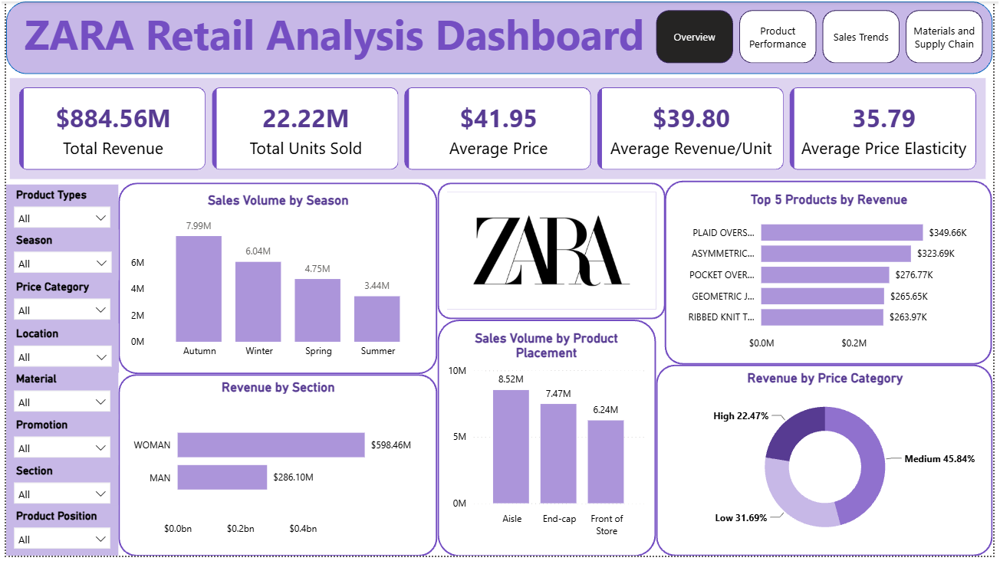

# ZARA Retail Analysis | End-to-End Retail Analytics Portfolio

**Excel · Python (Pandas) · SQL · Power BI · Business Reporting**

An independently developed portfolio case study using a ZARA-labelled retail product dataset to examine **estimated product revenue, sales volume, merchandising, seasonal patterns, materials, and sourcing geography**. The repository contains raw data, a prepared Excel dataset, a Python notebook, SQL analysis, four Power BI dashboard screenshots and the editable PBIX, a report, and a presentation.

> **Interpretation:** The source is a Kaggle dataset, not authenticated internal ZARA transactions. `Sales Volume × Price` is a **derived revenue estimate** from product-level fields—not verified booked revenue, profit, or live retail performance. No customer IDs, transaction dates, or actual cost data are supplied.

## Executive Snapshot

| KPI | Recomputed result | Definition |
|---|---:|---|
| Raw workbook records | 20,252 | Rows in `Zara_Cleaned_Data.xlsx` |
| Complete records after `dropna()` | 20,250 | Two rows removed because at least one field was missing |
| Unique product IDs after cleaning | 20,250 | Unique `Product ID` |
| Total units (dataset field) | 22,222,920 | `SUM(Sales Volume)` |
| **Estimated revenue** | **$884,557,744.72** | `SUM(Price × Sales Volume)` |
| Mean product price | $41.95 | Unweighted mean price across retained rows |
| Leading section by estimated revenue | WOMAN | $598,462,713.19 |
| Leading season | Autumn | $308,011,343.98 |
| Largest price band by estimated revenue | Medium ($35–<$70) | $405,492,612.53 |

These metrics were independently recomputed from the supplied Excel workbook using the notebook's **drop-all-null-rows** and price conversion logic. They are not assertions about ZARA's audited financial performance.

## Business Questions

1. Which products, sections, and price bands contribute the most estimated revenue?
2. How do product placement, promotions, and seasonal tags relate to sales volume?
3. Which materials and countries of origin dominate the product mix?
4. What does a cumulative-revenue Pareto analysis reveal about product concentration?
5. Which additional data would be required to establish true price elasticity, profitability, or supplier risk?

## Repository Structure

```text
ZARA Retail Analysis/
├── Data/
│   ├── Raw Data/
│   │   └── Zara_Raw_Data.csv
│   └── Clean Data/
│       └── Zara_Cleaned_Data.xlsx
├── Python/
│   └── Zara Retail Analysis .ipynb
├── SQL/
│   └── Zara Retail Analysis.sql
├── PowerBI/
│   ├── Zara Retail Analysis.pbix
│   └── Dashboard/
│       ├── Overview.png
│       ├── Product Performance.png
│       ├── Sales Trends.png
│       └── Materials and Supply Chain.png
├── Report/
│   └── Zara Retail Report.pdf
├── Presentation/
│   └── Zara Retail Analysis.pptx
└── README.md
```

The README is intended to be placed in the repository root, alongside `Data`, `Python`, `SQL`, `PowerBI`, `Report`, and `Presentation`.

## Data Source and Preparation

- **Dataset source cited by the original README:** [Kaggle – Business Sales](https://www.kaggle.com/datasets/ayeshaseherr/buisness-sales?resource=download). Verify the source and usage rights before publishing.
- **Raw data:** Semicolon-separated CSV with fields such as product ID, product position, promotion, seasonal flag, sales volume, price, section, season, material, and origin.
- **Prepared data:** `Data/Clean Data/Zara_Cleaned_Data.xlsx`, containing **20,252 rows and 15 columns**.
- **Notebook preparation:** Inspect nulls, remove rows with any missing values, normalize column names, remove brand and URL, parse price as a number, index by product ID, and engineer `price_category` and `price_elasticity`.
- **Missingness in prepared workbook:** One missing product name and two missing descriptions; **two total rows** are removed by the notebook's `dropna(how="any")` operation.

**Critical metric caveat:** The notebook computes `price_elasticity = sales_volume / price`. This is a **volume-to-price ratio, not economic price elasticity**. True price elasticity requires percentage change in quantity relative to percentage change in price, ideally with time-series or experiment data and controls. Treat the notebook field as an exploratory proxy only; do not claim measured elasticity or causal price sensitivity.

## Tools and Workflow

### Excel
The prepared workbook stores the structured data used by the notebook. The original README describes initial Text-to-Columns preparation; this step is not independently established from the final workbook alone.

### Python
- Open [`Python/Zara Retail Analysis .ipynb`](Python/Zara%20Retail%20Analysis%20.ipynb).
- Install dependencies: `pip install pandas openpyxl sqlalchemy psycopg2-binary jupyter`.
- Update the notebook's hard-coded Windows path to your own local `Data/Clean Data/Zara_Cleaned_Data.xlsx` location.
- **Remove the hard-coded PostgreSQL password before sharing or running the notebook** and rotate that credential. Use environment variables or a secure secret manager.
- Run the notebook sequentially. Its `to_sql(..., if_exists="replace", index=False)` operation **drops and recreates** the target table; back up existing data before execution.

### SQL: important database distinction
The supplied [`SQL/Zara Retail Analysis.sql`](SQL/Zara%20Retail%20Analysis.sql) uses **MySQL syntax**, including `CREATE DATABASE ZARA; USE ZARA;` and MySQL-style double-quoted string comparisons. The Python notebook, however, connects using **PostgreSQL** (`postgresql+psycopg2`) and writes to `public.sales_data` in a database named `ZARA`.

**Therefore, do not execute the SQL file unchanged in PostgreSQL.** Either run it in MySQL after loading a compatible `sales_data` table, or translate the SQL to PostgreSQL (create/connect to the database separately, use single-quoted string literals, and check function syntax). The project archive does **not** contain a validated PostgreSQL SQL script.

The SQL file contains 10 business-analysis questions covering top products, merchandising position, product revenue, window ranking, the notebook's volume/price proxy, promotions and seasonality, seasonal revenue, Pareto concentration, materials, and low-price products.

### Power BI
Open [`PowerBI/Zara Retail Analysis.pbix`](PowerBI/Zara%20Retail%20Analysis.pbix) in Power BI Desktop. If necessary, update the local data-source path and refresh.

| Page | Screenshot | Intended focus |
|---|---|---|
| Overview | [Overview](PowerBI/Dashboard/Overview.png) | Headline metrics and high-level mix |
| Product Performance | [Product Performance](PowerBI/Dashboard/Product%20Performance.png) | Product ranking and price/category comparison |
| Sales Trends | [Sales Trends](PowerBI/Dashboard/Sales%20Trends.png) | Season, promotion, and volume comparisons |
| Materials and Supply Chain | [Materials and Supply Chain](PowerBI/Dashboard/Materials%20and%20Supply%20Chain.png) | Material and origin distribution |




### Report and Presentation
- [Business report (PDF)](Report/Zara%20Retail%20Report.pdf)
- [Presentation (PPTX)](Presentation/Zara%20Retail%20Analysis.pptx)

## Evidence-Based Findings

| Dimension | Finding | Estimated revenue |
|---|---|---:|
| Section | WOMAN | $598,462,713.19 |
| Section | MAN | $286,095,031.53 |
| Season | Autumn | $308,011,343.98 |
| Season | Winter | $250,234,572.06 |
| Price band | Medium | $405,492,612.53 |
| Material | Wool | $170,227,727.16 |
| Origin | China | $176,093,385.05 |

- WOMAN contributes **67.7%** of estimated revenue.
- Autumn contributes **34.8%** of estimated revenue; season labels are **not** calendar dates or evidence of temporal growth.
- Medium-priced products contribute **45.8%** of estimated revenue using the notebook's `$35` and `$70` cutoffs.
- China accounts for **19.9%** of estimated revenue by product-origin label. This alone does not establish supplier dependency or procurement risk.

## Recommendations to Validate

1. **Product mix:** Review high-revenue products alongside margins, returns, and stock availability before changing assortment.
2. **Seasonal planning:** Compare season-labelled product performance, then obtain dated transactions to build genuine time-series forecasts.
3. **Price analysis:** Replace the volume/price proxy with an appropriately designed elasticity study using price variation and controls.
4. **Sourcing exposure:** Review origin concentration alongside actual supplier IDs, lead times, and purchase volumes.
5. **Quality controls:** Reconcile the Python-derived dataset with SQL and Power BI before publishing final KPI cards.

## Limitations and Responsible Interpretation

- The dataset is product-level, with no transaction timestamp, order ID, customer ID, unit cost, or actual realized margin.
- `Price × Sales Volume` is **estimated gross sales value** under an assumption, not verified company revenue.
- `price_elasticity` in the notebook is **not** a valid elasticity estimate.
- SQL is written for **MySQL**, while the Python database connection targets **PostgreSQL**.
- The notebook contains a hard-coded password and environment-specific file path. **Remove/rotate the password before publishing the notebook to GitHub.**
- The dashboard pages are present as screenshots and a PBIX, but live refresh, model correctness, and interactions have not been independently tested here.

## Portfolio Summary

This project demonstrates a complete **portfolio workflow** from data preparation and Python EDA through SQL analysis, Power BI storytelling, and business recommendations. It also highlights the importance of metric definitions, database compatibility, reproducibility, and communicating the limitations of proxy measures.
